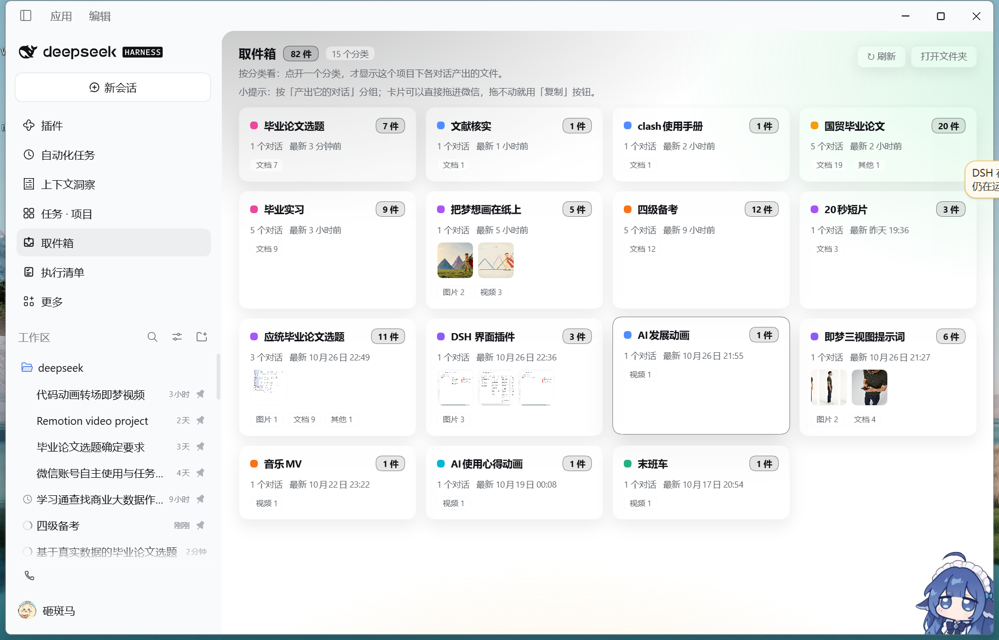
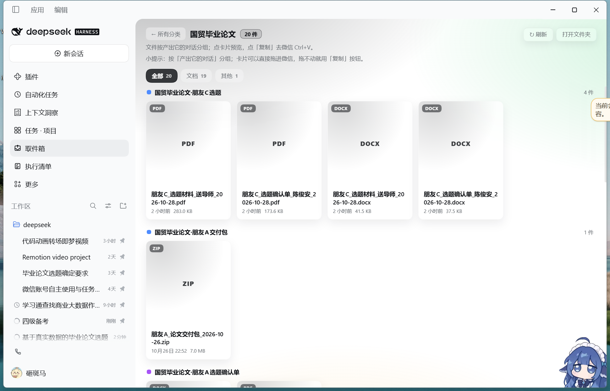
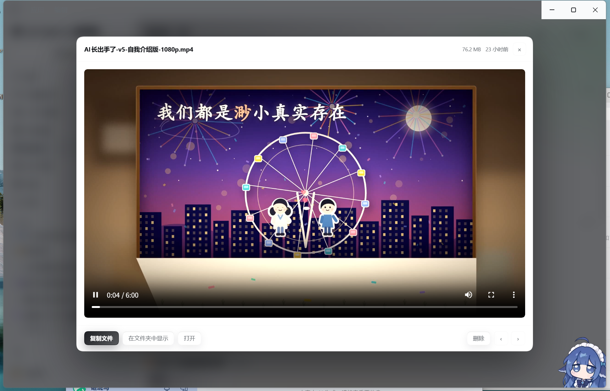

# Delivery Box · 取件箱

> **A delivery inbox for [DeepSeek Harness](https://github.com/deepseek-ai/deepseek-harness) (`dsh`).**
> Every file the agent produces lands in one folder. A sidebar panel groups those files by project —
> open a project to see the files **each conversation** produced — previews them inline, and copies an
> image or a file **straight to the clipboard** so you can paste it into WeChat with `Ctrl+V`.
> Windows desktop focus; the panel, previews and categories work anywhere dsh Web does.

This is an independent community plugin, not a DeepSeek product. Tested with **DSH 0.2.1-rc.3 on Windows 11**.







## Why

An agent finishes a picture, a document or a video — and it is somewhere in a project folder you have to
dig out yourself. Even with a nice chat UI, "where is that file?" and "how do I send it to WeChat?"
stay manual work.

Delivery Box gives deliveries a **single, predictable destination** and a UI on top of it:

- **One folder for every deliverable.** Agents (or you) drop the finished file into the inbox folder.
- **Two-level navigation, like a project list.** Level 1 = categories (projects: dot, name, file count,
  number of conversations, last update, thumbnails). Level 2 = the files of that category,
  **grouped again by the conversation that produced them** — which chat made which file, at a glance.
- **Preview without opening anything.** Images, video (seekable), audio, PDF, plain text.
- **Copy to clipboard, then paste.** Images go to the *image* clipboard, everything else to the *file*
  clipboard — one `Ctrl+V` in WeChat / Teams / mail, no file picker.
- **Reveal in Explorer / open / delete to Recycle Bin** (never a hard delete).
- **Live.** The panel rescans the folder every 5 seconds; files dropped in by other sessions appear by themselves.

## Install

### A. From the plugin registry (recommended, needs `dsh` 0.2+)

```sh
dsh plugin --profile desktop add dsh-delivery-box
```

or, before it is published to npm, straight from GitHub:

```sh
dsh plugin --profile desktop add git+https://github.com/11zz-prog/dsh-delivery-box.git
```

Then restart DSH. The plugin appears as **取件箱 / Delivery Box** in the left sidebar.

### B. Desktop one-click (no CLI, Windows)

Download the release ZIP, extract it anywhere, double-click **`install.cmd`**, then fully restart DSH.
The installer finds your DSH home and profile, backs up the profile manifest and lockfile, links the plugin,
and writes `inbox.config.json` with your chosen inbox folder
(default `%USERPROFILE%\取件箱`). Uninstall with `uninstall.cmd`.

Cloned the repo instead of a release? Run `installer\install.cmd` — it detects the repository layout
and links the checkout directly (no copy).

> No admin rights, and no separate Node.js install is required: the installer uses the Node that ships
> with DSH.

## Configure

The inbox folder is resolved in this order:

1. `DSH_INBOX_DIR` environment variable
2. `inbox.config.json` next to the plugin (`{ "inboxDir": "D:\\Inbox" }`)
3. `%USERPROFILE%\取件箱`

Change it by editing `inbox.config.json` (or setting the variable) and restarting DSH.

## Let the agent deliver automatically

Add a rule to your workspace `AGENTS.md` so every session files its output into the inbox:

```md
## Delivery inbox: file every deliverable

After producing a finished file (image / video / document / report / audio / archive), run:

& "<plugin dir>\tools\投递.cmd" add <file> --origin "<this conversation or project>" --clip --json

- --origin: the conversation/project that produced it (the panel groups by it; do not omit)
- --clip: also put it on the clipboard (images → image clipboard, others → file clipboard)
- --link: hard-link large videos instead of copying (same volume; falls back to a copy)
```

`tools\投递.cmd` is generated by the installer and pins the local Node path. Without the installer,
call `node <plugin dir>\tools\inbox.mjs …` instead. Full template: [docs/AGENTS-snippet.md](docs/AGENTS-snippet.md).

## CLI (`tools/inbox.mjs`)

```text
inbox.mjs add <file> [--name "new name"] [--clip] [--reveal] [--link] [--origin "conversation"] [--project "project"] [--json]
inbox.mjs list [--json]
inbox.mjs copy [name|latest] [--mode auto|image|file] [--json]
inbox.mjs reveal [name|latest]
inbox.mjs tag [name|latest] --origin "conversation" [--project "project"] [--json]
inbox.mjs open
```

- `add` copies into the inbox (name collisions get `-2`), sets the intake time, optional clipboard copy.
- `--link` hard-links instead of copying (same volume only) — great for 100 MB videos.
- Source annotations live in the hidden `.origins.json` inside the inbox folder; the panel groups by them.
- Exit code is non-zero on failure (`NOT_FOUND` / `IS_DIR` / `NOT_IMAGE` / `BAD_NAME` / `EMPTY`).

## How it works

- **Host half** (`index.js`) registers seven loopback routes on DSH's web server:
  `GET /api/inbox/list`, `GET /api/inbox/file` (single-range `Range` support, so video seeking works),
  `POST /api/inbox/{copy,reveal,open,delete,open-folder}`. Node built-ins only — no dependencies.
- **Client half** (`client.js`) is a hand-written bundle (no build step) that registers a sidebar entry and a
  main panel through DSH slots, and renders with React taken from the host page.
- **Data** is just a folder: deliverables flat in one directory, plus two hidden files —
  `.origins.json` (who produced what) and optional `inbox.config.json`.
- Clipboard is written through Windows PowerShell (`-STA`, `-EncodedCommand`): image clipboard for images,
  file-drop list for everything else. Explorer reveal / Recycle Bin deletion use the same channel.

## Compatibility

| | |
|---|---|
| DSH | 0.2.x (tested 0.2.1-rc.3) |
| OS | Windows 10/11 for clipboard, Explorer and Recycle Bin features; the panel, categories, previews and file browsing are plain Web UI |
| Node | none needed for install (`dsh` ships its own); CLI needs Node 18+ |

## Security

- The routes are registered on the **local loopback** DSH web server and have **no authentication**:
  any local process can call them. Do not expose the DSH web port (or a tunnel to it) to the public internet.
- The plugin only reads/writes the inbox folder, the clipboard, and Explorer selection. Deletion goes to the
  Recycle Bin. Nothing is uploaded anywhere.
- Copying a file into the inbox duplicates it unless `--link` is used; hard-linked entries share the same file
  on disk (editing one edits both, deleting one keeps the other).

## Uninstall

- Registry install: `dsh plugin --profile desktop remove dsh-delivery-box`.
- Desktop install: double-click `uninstall.cmd` (rolls back the profile manifest/lockfile and removes the link;
  the plugin folder and the inbox files are kept).

## Development

```sh
git clone https://github.com/11zz-prog/dsh-delivery-box.git
cd dsh-delivery-box
npm run check          # syntax + manifest + packaging sanity checks, no dependencies
```

Layout: `index.js` (host), `client.js` (client bundle), `cordis.patch.yml` (bundle row), `tools/` (CLI,
optional desktop shortcut helper), `installer/` (Windows one-click install/uninstall), `docs/`.

## License

MIT — see [LICENSE](LICENSE).
